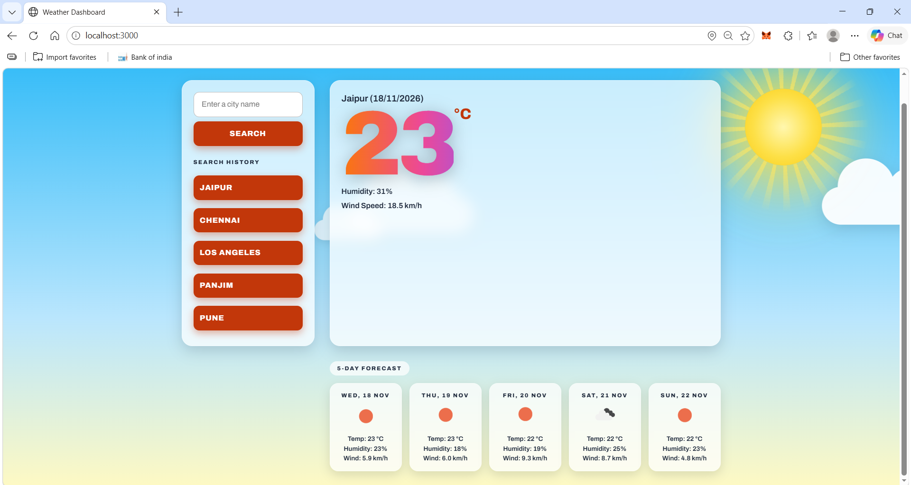
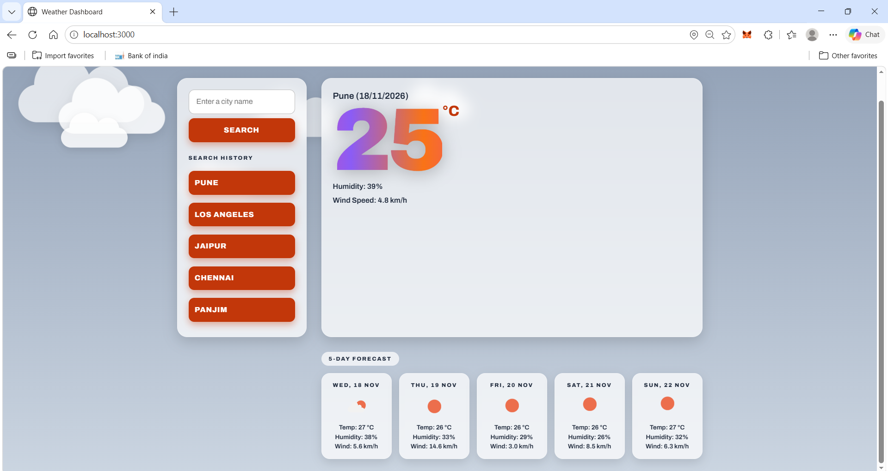
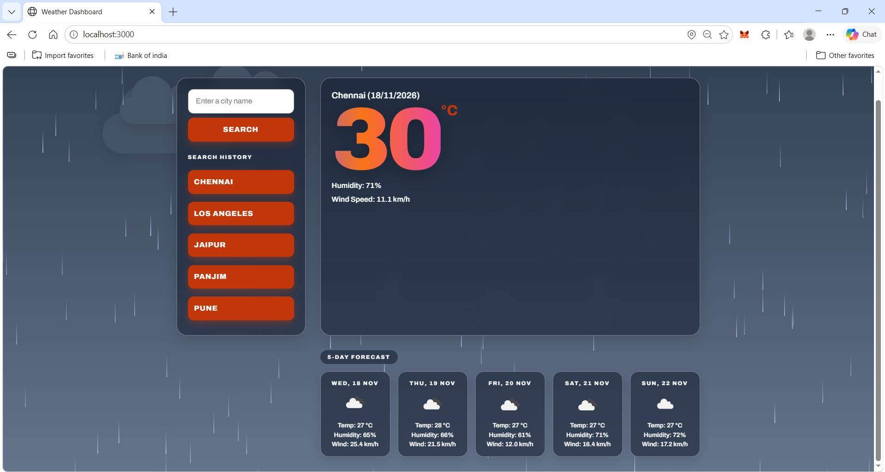
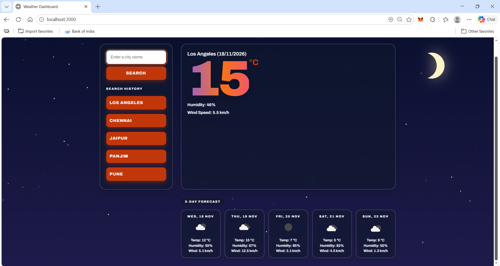

# Weather Dashboard

A weather app with a Node.js and Express server and an animated frontend. The page background changes with the live weather: sun, clouds, rain, thunderstorm, snow, mist or a night sky.

## Screenshots
| Sunny | Clouds | Rain | Night |
|---|---|---|---|
|  |  |  |  |

## Features
- Search any city, or use your current location
- Current temperature, humidity and wind speed (km/h)
- 5-day forecast and search history (saved in the browser)
- Animated weather scenes that switch automatically
- Responsive layout and reduced-motion support

## Tech stack
HTML, CSS, JavaScript, Node.js, Express, OpenWeatherMap API

## Setup
1. `git clone https://github.com/Abhishek-autade/weather-api-project.git`
2. `cd weather-api-project`
3. `npm install`
4. Copy `.env.example` to `.env` and add your OpenWeatherMap API key
5. `npm start`
6. Open http://localhost:3000

## How it works
The browser calls this app's own `/api/weather/...` routes. The server adds the secret API key and requests the current weather and forecast from OpenWeatherMap, so the key never reaches the browser.

## Future improvements
- Celsius/Fahrenheit toggle
- City autocomplete
- Hourly forecast chart
- Server-side caching and tests
